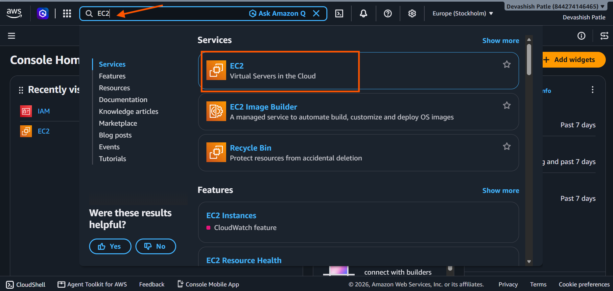
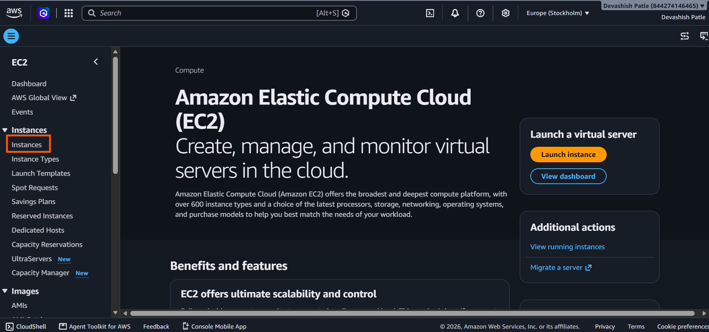
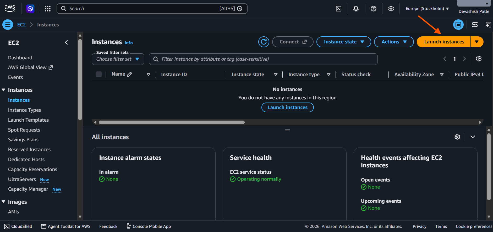
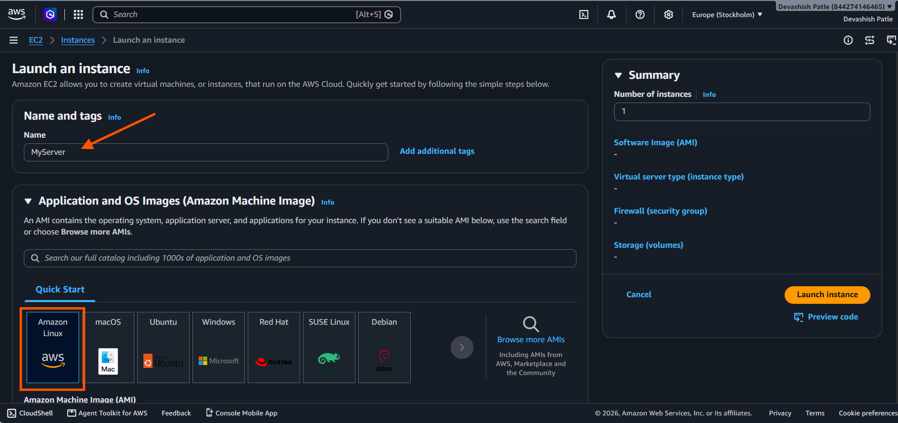
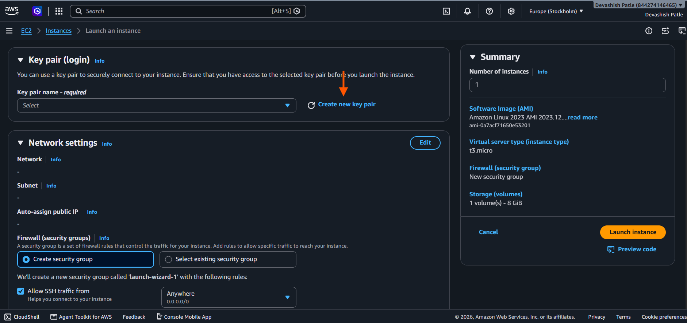
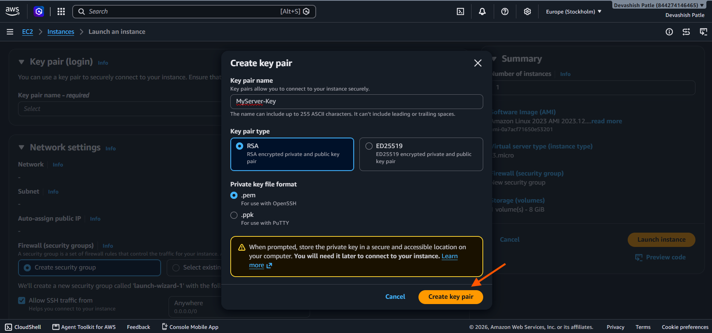

# AWS-EC2-Instance-Configuration

## 📌 Project Overview

This project demonstrates the initial steps of configuring and managing an Amazon EC2 instance using the AWS Management Console.

Amazon EC2 (Elastic Compute Cloud) provides virtual servers in the cloud. It allows users to launch computing resources, configure networking and security, connect to instances, and manage server capacity.

In this project, I started by searching for and opening the EC2 service in the AWS Console.

## 🎯 Project Objectives

- 🔍 Locate the Amazon EC2 service in AWS.
- 🖥️ Learn how to launch a virtual server.
- ⚙️ Configure an EC2 instance.
- 🔐 Understand key pairs and security groups.
- 🌐 Configure network access.
- 🔗 Learn how to connect to an instance.
- 🛠️ Practice basic EC2 instance management.

## 🧰 Services and Tools

| Tool | Purpose |
|---|---|
| ☁️ Amazon EC2 | Launch and manage virtual servers |
| 🐧 Amazon Machine Image (AMI) | Select the operating system image |
| 🔑 Key Pair | Authenticate securely when connecting to supported instances |
| 🛡️ Security Group | Control inbound and outbound traffic |
| 🌐 VPC | Provide network infrastructure for the instance |
| 💻 AWS Management Console | Configure and manage AWS resources |

---

## 🪜 Project Implementation

### Step 1: Search and Open Amazon EC2

**Procedure**

1. Sign in to the [AWS Management Console](https://console.aws.amazon.com/).
2. Locate the search bar at the top of the console.
3. Type `EC2` in the search bar.
4. Under **Services**, find **EC2 — Virtual Servers in the Cloud**.
5. Click the **EC2** service result.
6. Wait for the EC2 dashboard to open.

**Description**

I searched for EC2 using the AWS Console search bar and selected the Amazon EC2 service. Amazon EC2 provides virtual servers that can be launched and configured to run applications in the cloud.

**Screenshot**

---

## 🪜 Step 2: Open EC2 Instances

1. Open the **Amazon EC2** dashboard.
2. In the left-side navigation menu, find the **Instances** section.
3. Click **Instances** to open the EC2 Instances page.

**Description:**

I opened the EC2 Instances section from the left navigation menu to view and manage virtual servers in the selected AWS Region.

**Screenshot:**

---

## 🪜 Step 3: Launch an EC2 Instance

1. On the **EC2 Instances** page, click **Launch instances** in the top-right corner.
2. The **Launch an instance** configuration page will open.

**Description:**

I clicked **Launch instances** to start configuring a new EC2 virtual server.

**Screenshot:**

---

## 🪜 Step 4: Configure Instance Name and Select Amazon Linux AMI

1. Under **Name and tags**, enter `MyServer` in the **Name** field.
2. Under **Application and OS Images (Amazon Machine Image)**, select **Amazon Linux**.
3. Review the selected AMI details.
4. Continue to the next configuration section.

**Description:**

I entered `MyServer` as the EC2 instance name and selected Amazon Linux as the operating system. This helps identify the virtual server and defines the operating system used when launching the instance.

**Screenshot:**

---

## 🪜 Step 5: Configure Key Pair and Network Settings

1. Under **Key pair (login)**, click **Create new key pair**.
2. Enter a name for the key pair and select the required key pair options.
3. Create and download the key pair file securely.
4. Under **Network settings**, review the network and subnet options.
5. Keep **Create security group** selected to create a new security group.
6. Review the **Allow SSH traffic from** setting.
7. Before launching, restrict SSH access to your own IP address instead of **Anywhere**.

**Description:**

I configured the key pair required to connect securely to the EC2 instance. I also reviewed the network settings and selected the option to create a new security group. The security group controls incoming and outgoing network traffic to the instance.

**Screenshot:**

---

## 🔑 Step 6: Create an EC2 Key Pair

1. In the **Key pair (login)** section, click **Create new key pair**.
2. Enter `MyServer-Key` as the key pair name.
3. Select **RSA** as the key pair type.
4. Select `.pem` as the private key file format for OpenSSH.
5. Click **Create key pair** to download the private key file.
6. Store the downloaded `.pem` file in a safe location. You will need it to connect to your EC2 instance.

**Description:**

I created a key pair named `MyServer-Key` using RSA encryption and the `.pem` format. This key pair will help me securely connect to my EC2 instance.

**Screenshot:**

Security tip: Never upload your .pem private key file to GitHub or share it publicly.

---
