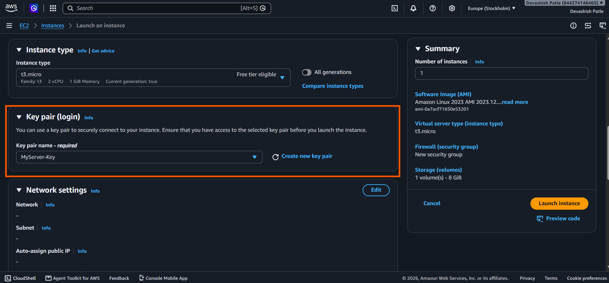
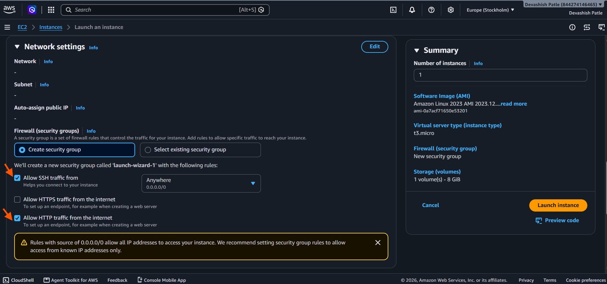
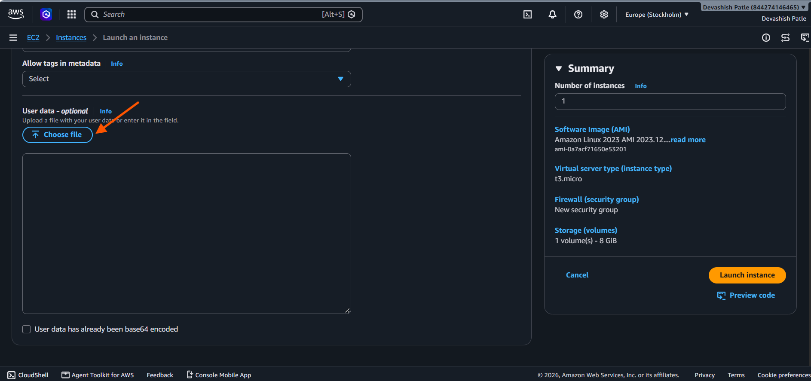
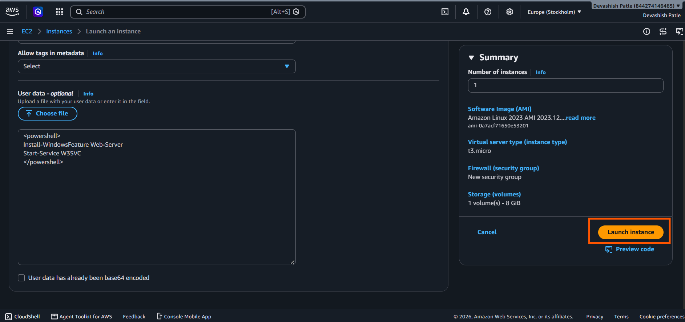
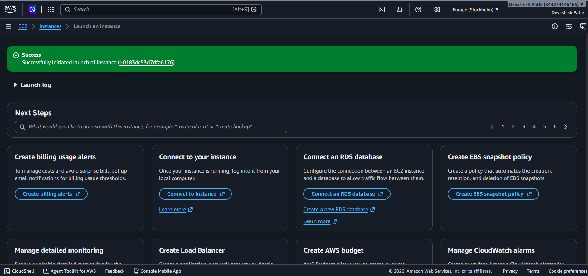
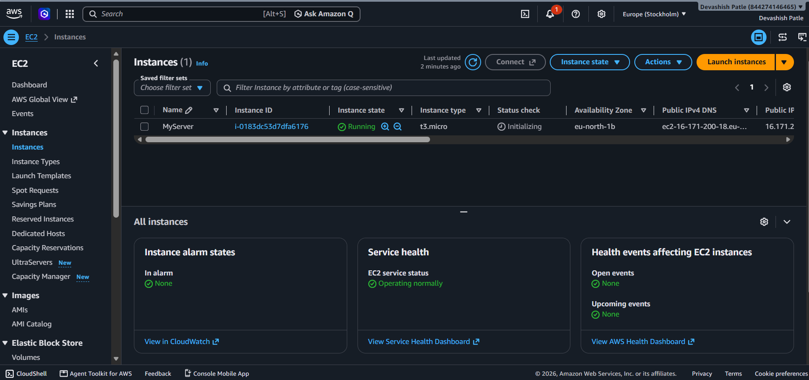

# AWS-EC2-Instance-Configuration

## 📌 Project Overview

This project demonstrates the initial steps of configuring and managing an Amazon EC2 instance using the AWS Management Console.

Amazon EC2 (Elastic Compute Cloud) provides virtual servers in the cloud. It allows users to launch computing resources, configure networking and security, connect to instances, and manage server capacity.

In this project, I started by searching for and opening the EC2 service in the AWS Console.

## 🎯 Project Objectives

- 🔍 Locate the Amazon EC2 service in AWS.
- 🖥️ Learn how to launch a virtual server.
- ⚙️ Configure an EC2 instance.
- 🔐 Understand key pairs and security groups.
- 🌐 Configure network access.
- 🔗 Learn how to connect to an instance.
- 🛠️ Practice basic EC2 instance management.

## 🧰 Services and Tools

| Tool | Purpose |
|---|---|
| ☁️ Amazon EC2 | Launch and manage virtual servers |
| 🐧 Amazon Machine Image (AMI) | Select the operating system image |
| 🔑 Key Pair | Authenticate securely when connecting to supported instances |
| 🛡️ Security Group | Control inbound and outbound traffic |
| 🌐 VPC | Provide network infrastructure for the instance |
| 💻 AWS Management Console | Configure and manage AWS resources |

---

## 🪜 Project Implementation

### Step 1: Search and Open Amazon EC2

**Procedure**

1. Sign in to the [AWS Management Console](https://console.aws.amazon.com/).
2. Locate the search bar at the top of the console.
3. Type `EC2` in the search bar.
4. Under **Services**, find **EC2 — Virtual Servers in the Cloud**.
5. Click the **EC2** service result.
6. Wait for the EC2 dashboard to open.

**Description**

I searched for EC2 using the AWS Console search bar and selected the Amazon EC2 service. Amazon EC2 provides virtual servers that can be launched and configured to run applications in the cloud.

**Screenshot**

---

## 🪜 Step 2: Open EC2 Instances

1. Open the **Amazon EC2** dashboard.
2. In the left-side navigation menu, find the **Instances** section.
3. Click **Instances** to open the EC2 Instances page.

**Description:**

I opened the EC2 Instances section from the left navigation menu to view and manage virtual servers in the selected AWS Region.

**Screenshot:**

---

## 🪜 Step 3: Launch an EC2 Instance

1. On the **EC2 Instances** page, click **Launch instances** in the top-right corner.
2. The **Launch an instance** configuration page will open.

**Description:**

I clicked **Launch instances** to start configuring a new EC2 virtual server.

**Screenshot:**

---

## 🪜 Step 4: Configure Instance Name and Select Amazon Linux AMI

1. Under **Name and tags**, enter `MyServer` in the **Name** field.
2. Under **Application and OS Images (Amazon Machine Image)**, select **Amazon Linux**.
3. Review the selected AMI details.
4. Continue to the next configuration section.

**Description:**

I entered `MyServer` as the EC2 instance name and selected Amazon Linux as the operating system. This helps identify the virtual server and defines the operating system used when launching the instance.

**Screenshot:**

---

## 🪜 Step 5: Configure Key Pair and Network Settings

1. Under **Key pair (login)**, click **Create new key pair**.
2. Enter a name for the key pair and select the required key pair options.
3. Create and download the key pair file securely.
4. Under **Network settings**, review the network and subnet options.
5. Keep **Create security group** selected to create a new security group.
6. Review the **Allow SSH traffic from** setting.
7. Before launching, restrict SSH access to your own IP address instead of **Anywhere**.

**Description:**

I configured the key pair required to connect securely to the EC2 instance. I also reviewed the network settings and selected the option to create a new security group. The security group controls incoming and outgoing network traffic to the instance.

**Screenshot:**

---

## 🔑 Step 6: Create an EC2 Key Pair

1. In the **Key pair (login)** section, click **Create new key pair**.
2. Enter `MyServer-Key` as the key pair name.
3. Select **RSA** as the key pair type.
4. Select `.pem` as the private key file format for OpenSSH.
5. Click **Create key pair** to download the private key file.
6. Store the downloaded `.pem` file in a safe location. You will need it to connect to your EC2 instance.

**Description:**

I created a key pair named `MyServer-Key` using RSA encryption and the `.pem` format. This key pair will help me securely connect to my EC2 instance.

**Screenshot:**

Security tip: Never upload your .pem private key file to GitHub or share it publicly.

---

## ⚙️ Step 7: Select the EC2 Key Pair

1. In the **Instance type** section, review the selected instance type `t3.micro`.
2. Scroll down to the **Key pair (login)** section.
3. Click the **Key pair name** dropdown.
4. Select the previously created key pair `MyServer-Key`.
5. Verify that the correct key pair is selected before proceeding.

**Description:**

I selected the `MyServer-Key` key pair for my EC2 instance. The instance type is set to `t3.micro`, which provides 2 vCPUs and 1 GiB of memory. The key pair will be used for secure instance access.

**Screenshot:**

---

## 🔒 Step 8: Configure Network and Security Group Settings

1. Go to the **Network settings** section on the EC2 launch page.
2. Select **Create security group** to create a new security group.
3. Keep **Allow SSH traffic from** selected to enable remote server access.
4. Select **Allow HTTP traffic from the internet** if you plan to host a website.
5. Review the warning about allowing access from all IP addresses (`0.0.0.0/0`).
6. For better security, restrict SSH access to **My IP** before launching the instance.

**Description:**

I configured the EC2 network settings and reviewed the security group rules. SSH allows remote administration, while HTTP allows web traffic. These rules control which network connections can reach the EC2 instance.

**Screenshot:**

---

## 🪜 Step 9: Configure Advanced Details and User Data

1. Scroll down to the **Advanced details** section on the EC2 launch page.
2. Locate the **User data – optional** field.
3. If you need to run commands automatically when the instance starts, enter a startup script in the text box or click **Choose file** to upload a script.
4. For a basic EC2 configuration, leave the User data field empty.
5. Review the settings before launching the instance.

**Description:**

I reviewed the advanced configuration options for my EC2 instance. The User data feature allows startup scripts to run automatically when an instance launches. This can be used to install software or configure a web server.

**Screenshot:**

---

## 🚀 Step 10: Add User Data and Launch the EC2 Instance

1. In the **User data – optional** text box, enter the startup script.
2. The screenshot shows a PowerShell script intended to install the Windows Web Server feature and start the `W3SVC` service.
3. Review the configuration in the **Summary** panel, including the Amazon Linux AMI, `t3.micro` instance type, security group, and 8 GiB storage.
4. Click **Launch instance** to start creating the virtual server.

**Description:**

I added a user data script and prepared the EC2 instance for launch. User data can automate software installation and service configuration when an instance starts.

**Important:** The screenshot uses a PowerShell script for Windows, but the selected AMI is **Amazon Linux 2023**. These do not match. For Amazon Linux, use a Linux shell script beginning with `#!/bin/bash`, or select a Windows AMI if you want to use PowerShell.

**Screenshot:**

---

## ✅ Step 11: Successfully Launch the EC2 Instance

1. After configuring the instance settings, click **Launch instance**.
2. Wait for AWS to process the launch request.
3. Check the green success message displayed at the top of the page.
4. Note the EC2 instance ID shown in the confirmation message.
5. Click the instance ID or return to the **Instances** page to check the instance status.

**Description:**

I successfully initiated the launch of my Amazon EC2 instance. AWS generated an instance ID to identify the virtual server. The instance can now be monitored from the EC2 dashboard.

**Screenshot:**

Note: A successful launch message confirms that the launch was initiated. Wait until the instance state shows Running and its status checks pass before connecting to it.

---

## 🖥️ Step 12: Verify the EC2 Instance Status

1. Open the **EC2 Dashboard** from the AWS Management Console.
2. In the left navigation panel, click **Instances**.
3. Locate the instance named `MyServer`.
4. Verify that the **Instance state** shows `Running`.
5. Check the **Instance type** (`t3.micro`) and review the **Status check** column.
6. Wait for the status checks to complete successfully before connecting to the instance.

**Description:**

I verified my EC2 instance in the Instances dashboard. The instance named `MyServer` is running, and AWS displays its instance ID, instance type, availability zone, and public IP information. The status check is still initializing, so I need to wait until it completes.

**Screenshot:**

